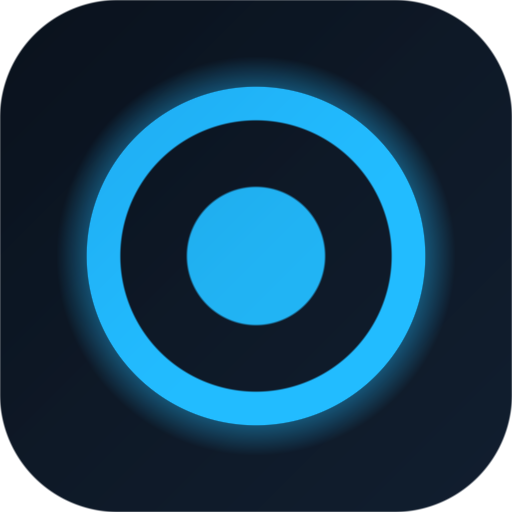

# SkyRec Studio

<p align="center">
  
</p>

<p align="center">
  A Windows screen recorder with a real multi-track editor built in — black and sky-blue, hardware accelerated, no cloud, no telemetry, no fake features.
</p>

SkyRec Studio records a display, a single window or a cropped region with
microphone and system audio, a webcam bubble and real cursor / click / typing
effects. Every recording opens straight into the editor, where the same project
you preview is the project FFmpeg renders to MP4, MKV or WebM.

```
Record  →  Edit  →  Export      all local, all real
```

---

## Contents

- [Highlights](#highlights)
- [Install](#install)
- [Screens](#screens)
- [Recording](#recording)
- [Mouse & keyboard effects](#mouse--keyboard-effects)
- [Editor](#editor)
- [Library, screenshots and settings](#library-screenshots-and-settings)
- [Keyboard shortcuts](#keyboard-shortcuts)
- [Build from source](#build-from-source)
- [Architecture](#architecture)
- [Where files live](#where-files-live)
- [Privacy](#privacy)
- [Testing](#testing)
- [Releases](#releases)
- [Known limitations](#known-limitations)
- [Licensing](#licensing)

---

## Highlights

| | |
| --- | --- |
| **Real capture** | Electron + Chromium `getDisplayMedia`, fed by the exact `desktopCapturer` source you picked — full screen, one monitor, a window, or a normalised region. |
| **Real audio** | Microphone through Web Audio gain, plus Windows loopback system audio, mixed into the recording. |
| **Real effects** | A native input hook records pointer position, buttons and a coarse key id; clicks, ripples, keystrokes and cursor smoothing are drawn on the captured canvas and re-rendered from the same data on export. |
| **Real editor** | Multi-track timeline, split/trim/ripple-delete, crop, scale, speed, fades, dissolve, zoom, text, music, silence removal, undo/redo, frame-accurate seeking. |
| **Real export** | One FFmpeg `filter_complex` built from the project, NVENC / QSV / AMF / libx264, live progress parsed from `-progress pipe:1`, cancellable queue. |
| **Real recovery** | Every session writes chunks continuously; interrupted recordings are listed and remuxed on the next launch. |

## Install

### From a release (recommended)

1. Open the [Releases](https://github.com/itriedcoding/Blox-Recorder/releases) page.
2. Download `SkyRec-Studio-Setup-<version>.exe` from the latest release.
3. Run it. The installer is per-user (no administrator rights), installs into
   `%LOCALAPPDATA%\Programs\SkyRec Studio` and creates Start-menu and desktop shortcuts.
4. Launch **SkyRec Studio**.

> The installer is **not code-signed** (no certificate is available to this
> project), so Windows SmartScreen will show "Unknown publisher" the first time.
> Choose *More info → Run anyway*, or build it yourself from source.

Requirements: Windows 10 1809 or newer (Windows 11 recommended), 64-bit.
Windows 11 is required for system-audio loopback in some configurations.

### Uninstall

Settings → Apps → SkyRec Studio → Uninstall. Recordings, projects and settings
are kept; delete `%USERPROFILE%\Videos\SkyRec` and `%APPDATA%\skyrec` to remove
them too.

## Screens

The interface is a custom-titlebar workspace: a sky-blue rail on the left,
contextual panels, and a live preview surface. Five pages share one visual
language:

| Page | What it does |
| --- | --- |
| **Record** | Source picker (screens/windows with live thumbnails), region selector, resolution/FPS/quality, mic + system audio meters, webcam layout, effect toggles, presets, live timer and performance readout. |
| **Library** | Every recording and project on disk, with thumbnails, durations, sizes and one-click open / reveal / delete. |
| **Editor** | Preview + multi-track timeline + inspector. |
| **Screenshots** | Captured stills with a real annotation canvas (pen, arrow, rectangle, blur, crop, text). |
| **Exports** | The export queue with live stage, percentage, speed and ETA. |

> **Screenshots in this README are intentionally absent rather than faked.** The
> UI can only be rendered by Electron on a machine with a display server, which
> the environment used to build this repository does not have. To capture your
> own: run `npm run dev` on Windows, then use Win+Shift+S or the app's screenshot
> tool and drop the PNGs into `docs/screenshots/`.

## Recording

- **Sources** — every display (with physical bounds and DPI scale) and every
  capturable window, refreshed live. Screen thumbnails come from
  `desktopCapturer`; the chosen source is pinned in the main process so the
  browser picker cannot substitute a different one.
- **Region** — normalised rectangle inside the chosen monitor, applied in the
  compositor and reflected in the file.
- **Resolution** — Native, 720p, 1080p, 1440p or 4K, derived from the source
  aspect ratio (odd sizes corrected to even dimensions for H.264).
- **Frame rate** — 24/30/50/60/120 fps.
- **Quality** — low/medium/high/ultra bitrate tiers for the intermediate encode.
- **Audio** — pick any microphone, set its gain, toggle system audio and its
  gain. Both are monitored with live level meters before you record.
- **Webcam** — device picker, corner position, size, shape (circle/rounded/
  square), mirroring and offsets, composited into the frame.
- **Countdown** — configurable 0–10 s overlay before capture starts.
- **Pause / resume / stop** — pause excludes time from the recording and from
  effect timestamps; stop finalises through FFmpeg.
- **Formats** — MP4 (H.264) or MKV, with the intermediate WebM retained until the
  transcode succeeds.
- **Recovery** — chunks are appended to `raw.webm` continuously; if the app or
  the machine dies, the next launch offers to restore the session.
- **Live readout** — elapsed time, file size, FPS, dropped frames, CPU and memory.

## Mouse & keyboard effects

Effects are recorded as data, not baked pixels:

1. `uiohook-napi` samples global pointer and keyboard events at up to 60 Hz.
2. Coordinates are normalised to the captured rect; keystrokes are reduced to a
   numeric id — **no characters, no clipboard, no window titles are stored**.
3. `shared/effect-timeline.ts` maps the log onto timeline time, applying trims,
   splits, speed and clip offsets, and smooths the pointer path.
4. Click sounds and typing sounds are *synthesised* (`shared/effects-audio.ts`)
   so preview and export share one waveform — no licensing, no drift.
5. `engine/fx.ts` draws cursor highlight, click ripples (left/right distinct),
   keystroke bubbles and zoom-on-click; the editor's inspector lets you change
   every one of these after the fact, and the export re-bakes them.

Global capture is **off until you consent** in Settings, runs only while
recording, and reports an explicit reason when the native hook is unavailable.

## Editor

- **Tracks** — Screen, Overlay, Text, Microphone, Music; mute, hide, lock and
  per-track volume.
- **Clips** — drag to move, drag edges to trim, split at the playhead, ripple
  delete, silence removal driven by real FFmpeg `silencedetect` output.
- **Import** — drag files from Explorer or use Import; media is probed with
  FFprobe for duration, size, fps and audio presence.
- **Video** — crop rectangle, position/scale/rotation/opacity, speed 0.25×–4×
  (with pitch-correct audio via `atempo`), per-clip zoom with focus point and
  hold, fade in/out and dissolve transitions.
- **Text** — content, font, size, colour, background, alignment, bold/italic,
  shadow, duration and position; rendered identically in preview and export.
- **Audio** — per-clip volume, fade in/out, track and master volume, mixing with
  a limiter, optional FFT noise reduction on the recording audio.
- **Playback** — frame stepping, scrubbing, J/K/L, loop, and a preview that uses
  the same effect drawing code as the export.
- **Undo/redo** — 80-step history for every project mutation, plus auto-save to a
  recovery snapshot.

## Library, screenshots and settings

- **Library** — recordings and projects with thumbnails, sizes, durations,
  reveal-in-Explorer and delete.
- **Screenshots** — capture the selected source, annotate with pen/arrow/rect/
  blur/text/crop, save as PNG or copy to the clipboard.
- **Presets** — full recording configurations (resolution, fps, quality, audio,
  webcam, effects, region, countdown) with save/delete.
- **Settings** — theme (dark/light), output folders, FFmpeg/FFprobe overrides,
  default fps/resolution/encoder/format, countdown, auto-save interval, hardware
  monitor, effect defaults, input-capture consent and every keyboard shortcut.
- **Monitoring** — real CPU/memory/system stats polled from the main process and
  shown during recording.

## Keyboard shortcuts

Defaults (all editable in Settings):

| Action | Shortcut |
| --- | --- |
| Start / stop recording | `Ctrl+Shift+R` |
| Pause / resume | `Ctrl+Shift+P` |
| Screenshot | `Ctrl+Shift+S` |
| Open editor | `Ctrl+E` |
| New project | `Ctrl+N` |
| Save project | `Ctrl+S` |
| Export | `Ctrl+Shift+E` |
| Play / pause preview | `Space` |
| Step frame | `←` / `→` |
| Split at playhead | `S` |
| Undo / redo | `Ctrl+Z` / `Ctrl+Shift+Z` |

## Build from source

Requirements: Windows 10/11 (capture), Node.js 20+, npm 10+.
The editor and export engine build on any OS, but recording only works on Windows.

```bash
git clone https://github.com/itriedcoding/Blox-Recorder.git
cd Blox-Recorder
npm install
npm run icons        # generates build/icon.ico + PNGs
npm run dev          # Electron with hot reload
```

Useful scripts:

| Script | Purpose |
| --- | --- |
| `npm run dev` | Run the app with hot reload |
| `npm run typecheck` | Strict TypeScript for main, preload and renderer |
| `npm test` | Vitest: filter graph, timeline maths, effect audio, end-to-end render |
| `npm run verify:render` | Only the real FFmpeg render test (writes to `tests/.artifacts`) |
| `npm run build` | Typecheck + production bundles into `out/` |
| `npm run package:win` | Build the NSIS `.exe` into `release/` |
| `npm run package:dir` | Unpacked build for debugging packaging |

## Architecture

See [docs/ARCHITECTURE.md](docs/ARCHITECTURE.md) for the full breakdown: process
model, capture negotiation, compositor, effect sync, FFmpeg graph compilation,
storage layout and privacy model.

Short version:

- **Main process** (`src/main`) owns capture negotiation, chunk writing, FFmpeg,
  native input hooks, projects, settings, screenshots and the export queue.
- **Preload** (`src/preload`) exposes one typed, allow-listed `api` object.
- **Renderer** (`src/renderer`) is a sandboxed React + Zustand app with a canvas
  compositor, a playback engine and the timeline UI.
- **Shared** (`src/shared`) holds the domain model, timeline maths, effect
  synthesis and the FFmpeg filter-graph compiler used by both preview and export.

## Where files live

| Path | Contents |
| --- | --- |
| `%USERPROFILE%\Videos\SkyRec` | recordings and `.sessions` working folders |
| `%USERPROFILE%\Videos\SkyRec\Screenshots` | annotated stills |
| `%APPDATA%\skyrec\projects` | `*.skyrec.json` projects and autosaves |
| `%APPDATA%\skyrec\settings.json` | settings and shortcuts |
| `%APPDATA%\skyrec\presets.json` | recording presets |
| `%APPDATA%\skyrec\logs\main.log` | rotating application log |

All folders can be redirected in Settings.

## Privacy

- No network calls, no analytics, no accounts. Everything stays on the machine.
- Screen capture only ever starts from an explicit user action.
- Global keyboard capture requires consent, runs only while recording, and stores
  a coarse key id — never text, never clipboard contents.
- The renderer runs with `contextIsolation`, no Node integration, a strict CSP,
  and reaches the filesystem only through validated IPC handlers.

## Testing

```bash
npm test
```

- `tests/filtergraph.test.ts` — track registration, trim/speed, fades,
  transitions, zoom expressions, audio mixing, muted tracks, container choices.
- `tests/timeline-ops.test.ts` — split, trim, subtract-ranges and ripple delete.
- `tests/effects-audio.test.ts` — cue placement, volume/clipping, WAV container,
  event→timeline mapping including trims and out-of-range events.
- `tests/export-pipeline.test.ts` — **real** FFmpeg: generates source media,
  builds the project graph, renders a multi-track export with effects audio and a
  PNG overlay sequence, then verifies codecs, dimensions and duration with FFprobe.

GitHub Actions:

- `.github/workflows/ci.yml` — typecheck, tests, production build on every push.
- `.github/workflows/build-windows.yml` — on a `v*` tag (or manual dispatch):
  installs, typechecks, tests, builds, generates icons, packages the NSIS
  installer on `windows-latest`, verifies the `.exe` exists, uploads it as a
  build artefact and attaches it to the GitHub Release.

## Releases

The release flow is a tag push:

```bash
git tag v1.0.0
git push origin v1.0.0
```

The Windows workflow builds `release/SkyRec-Studio-Setup-1.0.0.exe` and publishes
it to a GitHub Release with generated notes. The release is only created when the
installer was produced and verified by the workflow — no empty assets.

## Known limitations

Read [docs/LIMITATIONS.md](docs/LIMITATIONS.md) — it lists every feature that is
intentionally narrower than a commercial NLE (custom sound-pack import, in-editor
voiceover recording, background removal, transition set, signing) and why.

## Licensing

Application code: MIT (see [LICENSE](LICENSE)).

Bundled binaries: the installer ships **FFmpeg/FFprobe** static builds under the
**GPLv3** (`ffmpeg-static`, `ffprobe-static`), invoked as separate executables.
`uiohook-napi` is MIT. Redistributing the installer means redistributing those
GPL binaries, with source available from <https://ffmpeg.org/download.html>.
